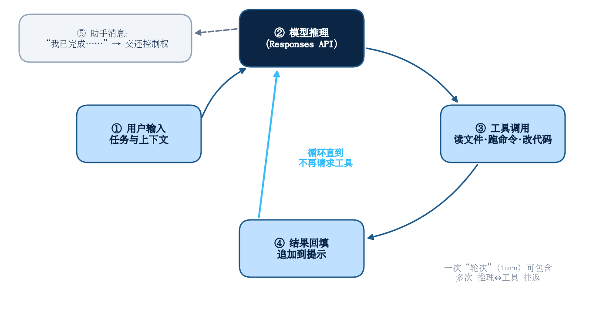
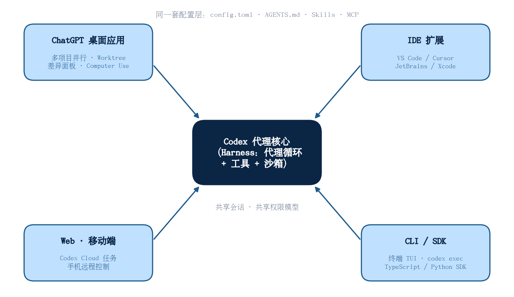
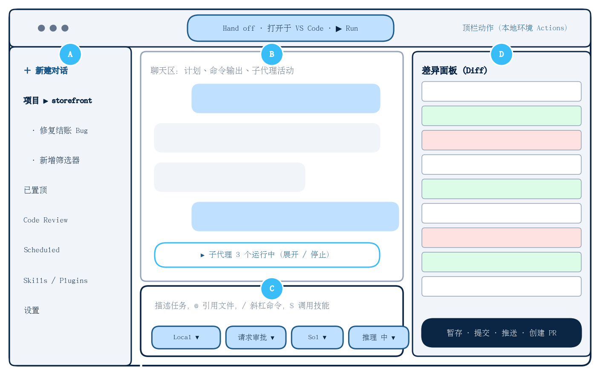
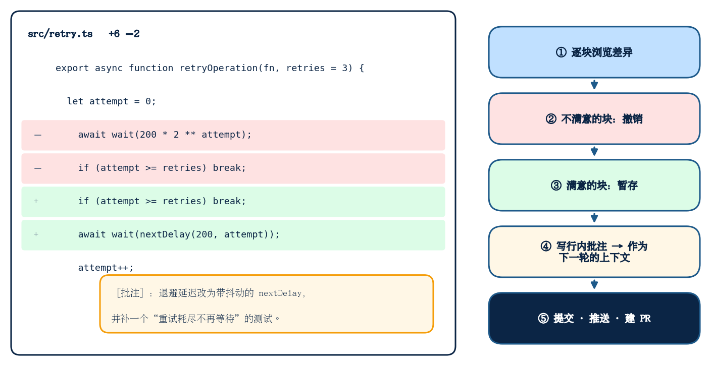
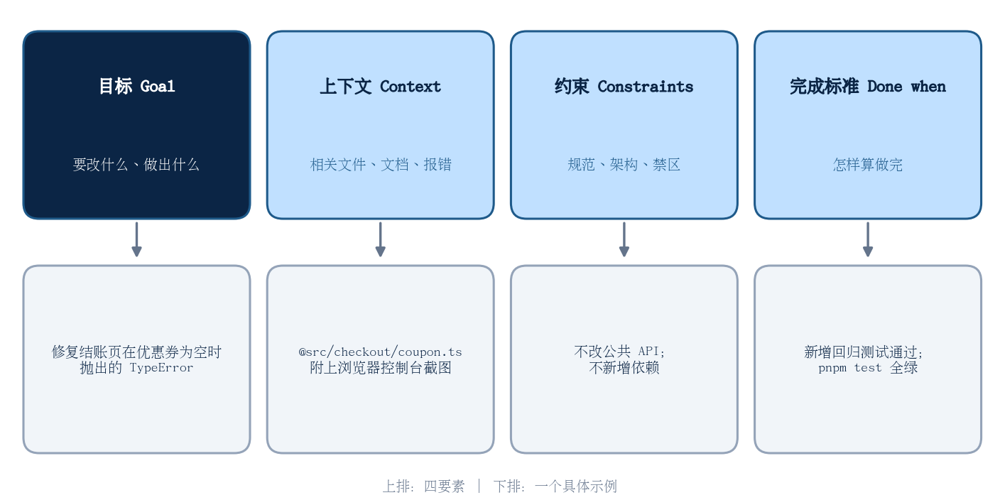
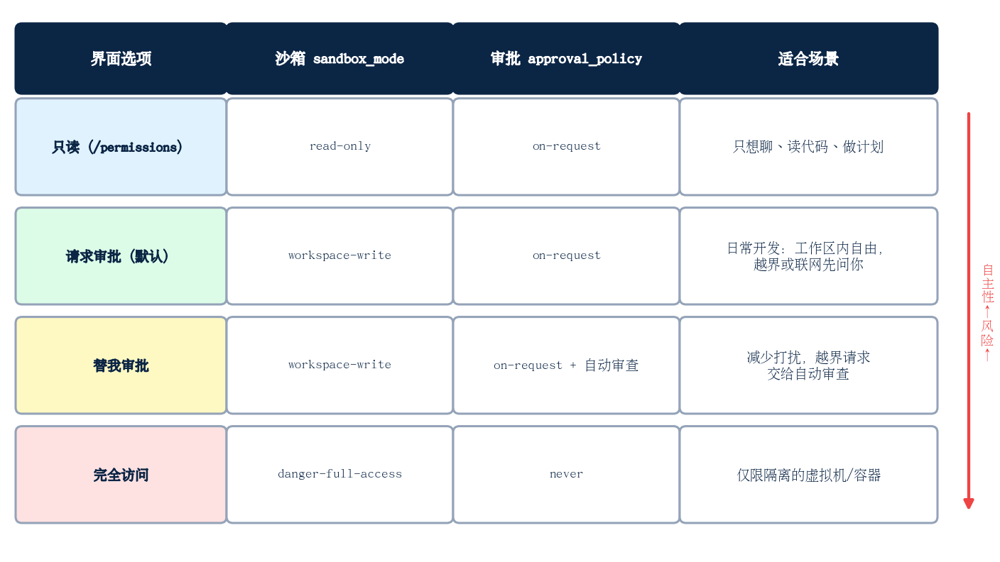
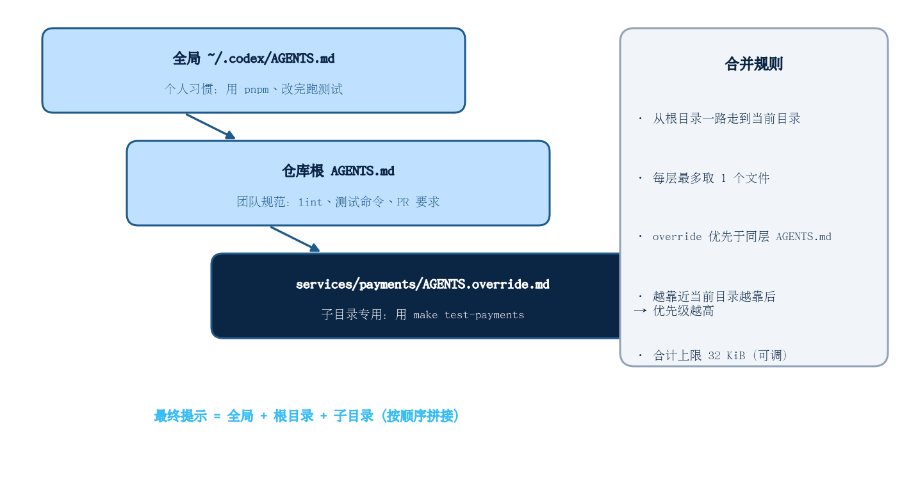

<!-- frontmatter: 前言 -->

# 前言

如果你曾在深夜对着一个顽固的 Bug 发呆，心里想“要是有个靠谱的同事能先帮我把调用链摸清楚就好了”——那么 Codex 就是为这样的时刻准备的。它不是一个只会补全下一行代码的插件，而是一个能读懂仓库、制定计划、修改文件、运行测试、并把结果交还给你审阅的**编程代理**（coding agent）。

这本书只有一个核心目标：**让你清晰、安全、高效地用好 Codex**。我们不追求罗列每一个开关，而是围绕真实工作中最有价值的四件事展开：

1. 用**图形界面**（ChatGPT 桌面应用中的 Codex、IDE 扩展、Web 与移动端）完成日常开发；
2. 用**子代理**把一个代理变成一支分工明确的小团队；
3. 在**多个 Harness 之间派工**——既让其他代理调度 Codex，也让 Codex 调度别人；
4. 用**云边协同**把本地的掌控感与云端的并行能力结合起来。

## 本书适合谁

本书写给三类读者：第一次接触编程代理、希望少走弯路的开发者；已经在用 Codex、想把它从“聊天工具”升级为“团队成员”的工程师；以及需要为团队制定 AI 协作规范的技术负责人。你不需要熟悉命令行——本书以图形界面为主线，命令行只在第 10 章做精简速成，其他章节仅在界面没有对应入口时才出现命令。

## 本书如何组织

全书分为五个部分：

- **第一部分　GUI 入门**（第 1～3 章）：认识 Codex，完成安装与第一个任务，学会写好提示、放对权限。
- **第二部分　并行与子代理**（第 4～5 章）：多会话与 Worktree 并行，子代理的触发、管理、自定义与编排。
- **第三部分　GUI 进阶能力**（第 6 章）：内置浏览器、Computer Use、代码评审、MCP、技能与定时任务。
- **第四部分　跨 Harness 派工**（第 7 章）：Codex 被调度与去调度的四种接入方式和一套协作协议。
- **第五部分　云边协同**（第 8～9 章）：Codex Cloud 的运行机制，以及本地、云端、手机、GitHub、Slack 联动的工作流。

第 10 章补充 IDE 扩展、CLI 速成与最佳实践；附录提供命令速查、配置样例与参考文献。

## 排版约定

本书使用以下约定：

- 界面中的菜单路径写作「设置 › MCP servers」，按钮名称保留界面原文，例如 **Hand off**、**Create branch here**。
- 快捷键以 macOS 写法给出（如 ⌘ + ,），Windows 上通常将 ⌘ 换成 Ctrl，请以「设置 › Keyboard Shortcuts」中显示的为准。
- `等宽字体` 表示文件名、配置键、斜杠命令或需要原样输入的文字。
- 方括号中的数字（如 [16]）指向书末参考文献。

> [!TIP]
> 这种方框表示技巧或建议，通常能帮你省下不少时间。

> [!NOTE]
> 这种方框表示补充说明或背景知识。

> [!WARNING]
> 这种方框表示警告：忽视它可能导致数据丢失、凭据泄露或难以撤回的操作。

## 版本说明

Codex 迭代很快。本书内容依据 2026 年 11 月公开的 OpenAI 官方文档撰写，书中的模型名（如 GPT-6.1 Sol、GPT-6 Luna）、菜单名与默认值均以当时文档为准。若你看到的界面与书中略有出入，请以应用内显示和官方文档为准——本书讲解的工作方法与心智模型不会因此过时。

书中所有示意图均为作者依据官方文档原创绘制的**示意图**，而非真实截图，用于说明结构与流程；每张图下方都注明了依据的资料来源。

<!-- part: 第一部分 | GUI 入门 | 认识 Codex，完成第一个任务，学会把话说清楚、把权放对。 -->

# 第 1 章　认识 Codex

在动手之前，先花几分钟建立一个正确的心智模型。很多人用不好编程代理，不是因为提示写得差，而是把它当成了“更聪明的自动补全”。本章回答三个问题：Codex 是什么？它是怎么工作的？我该从哪个入口开始用？

## 1.1　从代码补全到编程代理

传统的 AI 编程助手是“被动”的：你写一半，它补一半。编程代理则是“主动”的：你描述一个目标，它自己决定要读哪些文件、跑哪些命令、改哪些代码，并在做完之后向你汇报。OpenAI 把 Codex CLI 描述为一个在你电脑上本地运行的编程代理 [2]；在桌面应用、IDE 扩展和云端，它也以同样的方式工作。

具体来说，Codex 可以：

- **理解陌生代码库**：梳理目录结构、追踪调用链、解释某个模块为什么这样设计；
- **做聚焦的改动**：修 Bug、加功能、重构、补测试；
- **运行本地工具**：执行测试、lint、构建脚本，并根据结果继续修正；
- **评审变更**：对未提交的改动、某次提交或整个分支给出按优先级排序的问题清单 [1]。

> [!NOTE]
> 在 OpenAI 的术语里，“Codex”是一组软件代理产品的统称，包括 CLI、云端、IDE 扩展等；它们共享同一个核心，官方称之为 **Codex harness**——负责代理循环与执行逻辑的那部分程序 [3]。本书第 7 章会反复用到“Harness”这个词。

## 1.2　代理循环：Codex 如何“思考”

所有编程代理的心脏都是一个**代理循环**（agent loop）[3]。理解它，你就能理解 Codex 的大部分行为：为什么它有时会连跑十几条命令，为什么对话越长越可能“走神”，为什么权限设置如此重要。



如图 1-2 所示，循环分为几步：

1. **用户输入**：你的任务描述、引用的文件、附加的截图，连同 AGENTS.md 中的项目说明，被组装成提示；
2. **模型推理**：Codex 把提示发送给模型（通过 Responses API），模型要么直接给出答复，要么请求调用工具，例如“运行 `ls` 并告诉我输出”；
3. **工具调用**：Codex 在沙箱中执行这个请求——读文件、跑命令、改代码；
4. **结果回填**：工具的输出被追加到提示末尾，再次交给模型推理。

这个过程不断重复，直到模型不再请求工具、而是给出一条“助手消息”，例如“我已经添加了你要的 architecture.md”。从你发出消息到收到这条答复，称为一个**轮次**（turn）。一个轮次里可能包含几十次推理与工具调用的往返 [3]。

这带来两个重要推论。第一，**对话越长，提示越长**：每个新轮次都会带上之前的全部历史，而模型的上下文窗口是有限的，所以管理上下文是代理的重要职责——这也是第 5 章子代理要解决的核心问题。第二，**代理的产出不只是文字**：它真正的产出是你磁盘上被修改的代码，因此“它能碰什么、什么时候要问你”必须事先约定好，这就是第 3 章的权限模型。

## 1.3　四种入口，一个内核

Codex 提供四种主要入口，它们共享同一套配置层（`config.toml`、AGENTS.md、技能、MCP 服务器），你可以在它们之间自由切换而无需重复配置 [14][19]。



**ChatGPT 桌面应用**是本书的主战场。在桌面应用中选择 Codex，你可以同时推进多个项目、在 Worktree 中并行开发、在差异面板里逐块审阅改动、使用内置浏览器和 Computer Use 操作图形界面，还能创建定时任务 [4][5]。

**IDE 扩展**适合“就在代码旁边”的工作：VS Code、Cursor、Windsurf 使用 Codex 扩展，Xcode 与 JetBrains IDE 提供各自的集成。它能直接引用你打开的文件和选中的代码，并在编辑器里就地展示差异 [34]。

**Web 与移动端**连接的是 Codex Cloud：任务在 OpenAI 托管的云端环境中运行，你可以在网页、手机或桌面应用里查看进度、审阅改动、继续追问 [26]。手机还可以远程控制你的桌面电脑 [28]。

**CLI 与 SDK**面向终端用户和自动化场景：交互式终端界面、非交互的 `codex exec`、以及 TypeScript/Python SDK [22][32]。

表 1-1 给出了一个快速选择指南。

| 你的场景 | 推荐入口 | 理由 |
|---|---|---|
| 第一次上手、想看清每一步 | 桌面应用 | 界面直观，差异面板与权限控件一目了然 |
| 正在编辑器里写代码 | IDE 扩展 | 选中即上下文，就地审阅改动 |
| 同时推进多个需求 | 桌面应用 + Worktree | 前台/后台分离，互不干扰 |
| 长任务、不想占用本机 | Codex Cloud | 云端运行，可并行，可在手机上跟进 |
| 出门在外要审批或追加指令 | 移动端远程控制 | 代码仍在你的电脑上运行 |
| 脚本、CI、被其他代理调用 | CLI / SDK | 可编程、可输出结构化结果 |

## 1.4　套餐、用量与模型

Codex 与 ChatGPT Work 共享定价、额度与用量限制，包含在 ChatGPT 的 Free、Go、Plus、Pro、Business、Edu、Enterprise 等套餐中；使用 API Key 登录时则按 API 价格单独计费 [35]。不同套餐可用的入口和模型有所不同，例如 Free 与 Go 主要在桌面应用中使用 GPT-6 Luna，Plus 及以上可以在 Web、CLI、IDE 扩展和 iOS 中使用，并可使用 GPT-6.1 Sol [35]。

用量并不只取决于你打了多少字。模型选择、上下文长度、推理强度、工具调用和缓存都会影响消耗；一个小脚本可能只用掉额度的一小部分，而长时间运行、需要保持大量上下文的任务会消耗多得多 [35]。在桌面应用中，可以随时输入 `/status` 查看当前对话的上下文占用与速率限制，输入 `/usage` 打开用量与账单设置 [7]。

> [!TIP]
> 子代理会显著增加 token 消耗：每个子代理都独立进行推理和工具调用 [16]。在第 5 章学会“什么时候不该用子代理”，和学会怎么用它同样重要。

## 1.5　本章小结

- Codex 是一个**编程代理**，它的核心是“推理 → 工具调用 → 结果回填”的代理循环。
- 对话越长，提示越长；代理的真实产出是你磁盘上的代码——这两点决定了上下文管理与权限设置的重要性。
- 桌面应用、IDE 扩展、Web/移动端、CLI/SDK 四种入口共享同一套配置。本书以桌面应用为主线。

# 第 2 章　桌面应用上手：界面导览与第一个任务

本章带你从零完成安装、登录，认识桌面应用的每一块界面，并完整走一遍“提出任务 → 审阅改动 → 提交”的流程。读完本章，你就能独立用 Codex 完成一个小需求。

## 2.1　安装与登录

Codex 的桌面体验内置在 **ChatGPT 桌面应用**中，支持 macOS 与 Windows [4][5]。

1. **下载安装**。从 OpenAI 官网下载 ChatGPT 桌面应用。Windows 用户也可以在 PowerShell 中用 winget 安装 [5]：

```powershell
winget install --id 9PLM9XGG6VKS -s msstore
```

2. **登录**。打开应用，使用 ChatGPT 账号登录 [4]。
3. **选择 Codex**。应用顶部可以在 ChatGPT 与 Codex 之间切换；在 Codex 中点击 **New chat** 开始新对话 [4]。
4. **打开项目**。用 ⌘ + O（Windows 为 Ctrl + O）打开一个本地文件夹，Codex 就能读取其中的文件和上下文 [5][6]。

> [!NOTE]
> **Windows 用户请留意运行环境。** 桌面应用默认使用 Windows 原生的 Codex 代理，在 PowerShell 中执行命令，并启用 Windows 原生沙箱；你也可以把它配置为在 WSL2 中运行，此时使用 Linux 沙箱。要让沙箱生效，请在发送消息前在输入框下方选择 **Ask for approval** [5]。如果项目位于 WSL 文件系统，打开文件夹时在资源管理器地址栏输入 `\\wsl$\` 即可找到 [5]。

在「设置」中，Windows 用户还可以选择默认的编辑器（如 VS Code、Visual Studio）和默认的集成终端（PowerShell、命令提示符、Git Bash 或 WSL）[5]。

> [!TIP]
> 第一次在真实项目上使用前，先做一个 Git 提交作为“检查点”。官方最佳实践建议在任务前后各创建一个 Git 检查点，以便随时回退 [1]。

## 2.2　界面导览

桌面应用的 Codex 界面可以分为四个区域，见图 2-1。



**A　侧栏**。顶部是“新建对话”，下方按项目组织对话；你可以置顶、归档、重命名对话。侧栏还提供 **Code Review**、**Scheduled**（定时任务）、Skills 与 Plugins 等入口 [18][21]。用 ⌘ + B 可以收起或展开侧栏 [6]。

**B　聊天区**。Codex 在这里展示它的计划、执行过的命令、命令输出摘要和最终答复。当子代理在运行时，这里会显示它们的活动，你可以点开查看每个子代理线程 [16]。

**C　输入框与控件条**。这是你最常打交道的地方：

- 输入任务描述；用 `@` 引用文件，用 `/` 调出斜杠命令，用 `$` 调用技能 [7][20]；
- 控件条上依次是**运行位置**（Local、Worktree 或 Cloud）、**权限**（如 Ask for approval）、**模型**与**推理强度**，以及 Worktree 的起始分支 [11][15]。

**D　差异面板与 Git 工具**。显示当前检出中的所有改动。你可以按块或按文件暂存、撤销，添加行内批注让 Codex 处理，提交、推送分支，甚至直接创建 Pull Request——全程不必离开应用 [8]。

此外还有两个实用的组件：**集成终端**（⌃ + \` 切换）用于执行界面没有暴露的操作；**顶栏动作**（Actions）是你为项目预先定义的常用命令按钮，比如“启动开发服务器”或“运行测试”，第 4 章会教你配置 [8]。

## 2.3　第一个任务：从提问到提交

我们用一个真实感十足的小任务来走一遍完整流程：某个重试函数在重试次数耗尽后还会多等待一次，需要修复。

**第一步：先让 Codex 了解项目。** 新建对话，输入：

```text
介绍一下这个项目：目录结构、技术栈、如何运行测试。
```

这是官方推荐的入门问题 [1]。Codex 会阅读 README、配置文件和目录结构，告诉你测试命令是什么。这一步看似多余，但它让后续任务的上下文更准确。

**第二步：描述任务。** 接着输入：

```text
@src/retry.ts 里的 retryOperation 在重试耗尽后还会多等一次退避延迟。
请修复：耗尽后立即抛出最后一次错误。
不要改函数签名。完成标准：新增一个测试覆盖“耗尽后不再等待”，
并且 pnpm test 全部通过。
```

注意这条提示包含了目标、上下文、约束和完成标准四个要素——第 3 章会详细讲解。

**第三步：观察执行。** 在默认的 **Ask for approval** 权限下，Codex 可以在项目目录内自由读文件、改代码、跑测试；如果它需要访问工作区以外的路径或联网，会弹出审批请求 [12]。你可以在聊天区看到它运行的每一条命令。

> [!TIP]
> Codex 工作时你可以随时追加消息。在「设置 › General › Follow-up behavior」中可以选择：追加的消息是**引导**（steer）当前这一轮，还是**排队**等下一轮再处理 [9]。发现它跑偏时，“引导”模式能及时把它拉回来。

**第四步：在差异面板中审阅。** Codex 完成后，打开差异面板逐块检查，见图 2-2。



对不满意的块直接撤销；对需要调整的地方添加**行内批注**——点击某一行写下意见，这条批注会作为上下文进入 Codex 的下一轮 [8][10]。例如：“退避延迟改成带抖动的 `nextDelay`。”Codex 会据此继续修改。

**第五步：提交。** 确认无误后，在差异面板中暂存、提交、推送分支并创建 PR [8]。如果想在提交前再多一道保险，可以输入 `/review` 让 Codex 对未提交的改动做一次评审 [7]。

## 2.4　常用快捷键

表 2-1 列出了最常用的快捷键（macOS 写法）[6]。Windows 上通常将 ⌘ 换成 Ctrl；如有不同，以「设置 › Keyboard Shortcuts」为准，你也可以在那里自定义绑定 [9]。

| 操作 | 快捷键 |
|---|---|
| 打开命令菜单 | ⌘ + K 或 ⌘ + ⇧ + P |
| 打开设置 | ⌘ + , |
| 打开文件夹 | ⌘ + O |
| 新建对话 | ⌘ + N |
| 切换侧栏 | ⌘ + B |
| 切换底部面板 | ⌘ + J |
| 切换集成终端 | ⌃ + \` |
| 打开旁支对话 | ⌘ + ⌥ + S |
| 下一个需要关注的对话 | ⌘ + ⌥ + A |
| 置顶 / 取消置顶对话 | ⌘ + ⌥ + P |
| 打开模型选择器 | ⌃ + ⇧ + M |

## 2.5　本章小结

- 在 ChatGPT 桌面应用中选择 Codex，打开项目文件夹即可开始；Windows 上默认使用 PowerShell 与原生沙箱。
- 界面四大区域：侧栏、聊天区、输入框与控件条、差异面板。
- 标准工作流：了解项目 → 描述任务 → 观察执行 → 逐块审阅并批注 → 评审与提交。

# 第 3 章　把话说清楚，把权放对

Codex 足够强大，即使提示不完美也常能给出不错的结果；但在大型代码库或高风险任务中，清晰的提示能显著提高可靠性 [10]。本章讲两件事：怎样**把话说清楚**（提示、计划模式、目标模式），以及怎样**把权放对**（权限控件、沙箱、AGENTS.md）。

## 3.1　好提示的四个要素

官方最佳实践建议，一条好的提示默认包含四样东西 [10]，见图 3-1。



- **目标**（Goal）：你想改变或构建什么？
- **上下文**（Context）：哪些文件、文件夹、文档、示例或报错与此相关？可以用 `@` 引用文件。
- **约束**（Constraints）：要遵循哪些规范、架构、安全要求或惯例？
- **完成标准**（Done when）：任务完成前什么必须为真？比如测试通过、行为改变、Bug 不再复现。

对比一下两种写法：

```text
✗ 结账页有 Bug，修一下。

✓ 目标：修复结账页在优惠券为空时抛出的 TypeError。
  上下文：@src/checkout/coupon.ts，附上控制台截图。
  约束：不改公共 API，不新增依赖。
  完成标准：新增回归测试通过，pnpm test 全绿。
```

第二种写法让 Codex 少做假设、范围更聚焦，产出也更容易审阅 [10]。

除了文字，你还可以直接把截图、设计稿拖进输入框作为上下文；在桌面应用中还可以使用**语音口述**来描述任务，这往往比打字更快 [10]。

## 3.2　计划模式、目标模式与旁支对话

**计划模式（/plan）**。当任务复杂、模糊或难以描述时，先让 Codex 规划再动手。计划模式会让 Codex 收集上下文、向你提出澄清问题，并在实现前形成更完善的计划。用 `/plan` 或 ⇧ + Tab 切换 [10]。

另一个有效的技巧是**让 Codex 采访你**：告诉它“先向我提问，挑战我的假设，把这个模糊的想法变成具体的需求，再写代码”[10]。

**目标模式（/goal）**。目标是一个持久化的目的，Codex 会持续朝它推进，直到完成、暂停或需要更多输入。推荐的用法是先用 `/plan` 把目标打磨清楚，再用 `/goal` 设定。目标激活后，输入框上方会出现进度条，上面有暂停、恢复、编辑目标和清除目标的按钮；目标运行期间你仍可以继续发消息引导它 [7]。

**旁支对话（/side）**。想临时问一个不相干的问题，又不想打断或污染主对话？输入 `/side`（或按 ⌘ + ⌥ + S）开启一个临时旁支对话 [6][7]。

**推理强度（/reasoning）**。对于范围明确、追求速度的任务选“低”；复杂改动或调试选“中”或“高”；长时间、推理密集的代理任务选“超高”[10]。可以用输入框下方的控件或 `/reasoning` 调整，用 `/model` 切换模型 [7]。

## 3.3　权限：沙箱与审批

Codex 的安全控制来自两层机制的配合 [12]：

- **沙箱模式**（sandbox mode）决定 Codex 在技术上**能做什么**——能写哪些目录、能否联网；
- **审批策略**（approval policy）决定 Codex **什么时候必须停下来问你**——比如越出沙箱、联网、运行受信任集合以外的命令。

在桌面应用中，这两层被合并成输入框下方的一个**权限控件**。根据你的配置，菜单中可能包含 **Ask for approval**（请求审批）、**Approve for me**（替我审批）、**Full access**（完全访问）以及命名或自定义的权限配置 [11]。它们与底层设置的对应关系见图 3-2。



- **只读**：Codex 可以查看文件，但不经审批不能编辑或运行命令。适合只想聊天、做计划的场景 [11]。
- **Ask for approval**（默认）：沙箱为 `workspace-write`，审批为 `on-request`。Codex 可以在工作目录内自动读文件、改代码、运行命令；编辑工作区外的文件或需要联网时会请求审批 [12]。
- **Approve for me**：沙箱同样是 `workspace-write`，但符合条件的审批请求会交给**自动审查**处理，而不是弹窗打扰你 [11]。
- **Full access**：取消沙箱限制，去掉文件系统和网络边界。只应在你确实希望代理拥有完全权限时使用 [11]。

> [!WARNING]
> 以完全访问模式运行时，Codex 不再局限于项目目录，可能执行意外的破坏性操作并导致数据丢失 [5]。官方建议保持沙箱边界，用规则做有针对性的例外；完全访问只应在外部已经隔离加固的环境（如一次性虚拟机或容器）中使用 [33]。

几个值得记住的默认行为：

- 在默认的 `workspace-write` 模式下，**网络访问默认关闭**，除非你在配置中开启 [12]；
- 沙箱不只约束内置的文件操作，Codex 运行的 git、包管理器、测试工具等子进程同样继承沙箱边界 [11]；
- 审批对话框有时会提供“仅此一次”或“本次会话”等范围，**选择能让任务继续的最窄范围**；不相关的仓库请用不同的项目或 Worktree 隔离，而不是放宽访问 [11]。

> [!TIP]
> 新手请从默认权限开始：保持审批和沙箱收紧，只在可信仓库或特定流程中、确实需要时再放宽 [10]。

## 3.4　AGENTS.md：写给代理的 README

当某种提示模式被证明有效，下一步就是**不再手动重复它**。AGENTS.md 是一个开放格式的、写给代理看的 README，它会自动加载进上下文，是编码“你和团队希望 Codex 如何在这个仓库里工作”的最佳位置 [10]。

**快速生成**。在项目对话中输入 `/init`，Codex 会为当前项目生成一个 AGENTS.md 骨架 [7]。这是很好的起点，但你应该修改它，使其符合团队真实的构建、测试、评审和发布方式 [10]。

**写什么**。一个好的 AGENTS.md 包括 [10]：

- 仓库布局和重要目录；
- 如何运行项目；
- 构建、测试、lint 命令；
- 工程规范和 PR 要求；
- 约束与禁止事项；
- “完成”意味着什么，如何验证。

```markdown
# AGENTS.md

## 仓库约定
- 包管理使用 pnpm；新增生产依赖前先征求确认。
- 修改 TypeScript 后运行 `pnpm lint && pnpm test`。

## 完成标准
- 新功能必须附带测试；公共工具函数的行为变更要同步更新 docs/。
```

**分层发现**。Codex 会在启动时构建一条指令链，见图 3-3 [13]。



1. **全局层**：Codex 主目录（默认 `~/.codex`）中的 AGENTS.md，存放个人习惯。在桌面应用中，也可以通过「设置 › Personalization」编辑所选机器上的个人指令 [9]。
2. **项目层**：从项目根目录（通常是 Git 根）一路走到当前目录，每层依次检查 `AGENTS.override.md`、`AGENTS.md`，每层最多取一个文件。
3. **合并**：从根向下拼接，越靠近当前目录的文件越靠后，因此优先级越高。合并后的总大小默认上限为 32 KiB [13]。

> [!TIP]
> 保持 AGENTS.md 简短、准确。一份精炼的文件比一份充满模糊规则的长文件有用得多。当 Codex 第二次犯同样的错误时，让它做一次复盘，然后更新 AGENTS.md——这样规则始终来自真实的摩擦 [10]。

**记忆**。在「设置 › Personalization」中开启 **Enable Codex memories**（如可用），Codex 可以把过往对话中有用的上下文带入未来的工作；也可以用 `/memories` 为单个对话配置是否使用或生成记忆 [7][9]。

## 3.5　本章小结

- 好提示 = 目标 + 上下文 + 约束 + 完成标准。复杂任务先 `/plan`，长期目标用 `/goal`，临时问题开 `/side`。
- 权限控件背后是“沙箱 + 审批”两层机制。默认的 Ask for approval 已经足够顺手；Full access 只用于隔离环境。
- 用 `/init` 生成 AGENTS.md，再按团队实际情况精简修改；全局、项目、子目录三层叠加，越近越优先。
