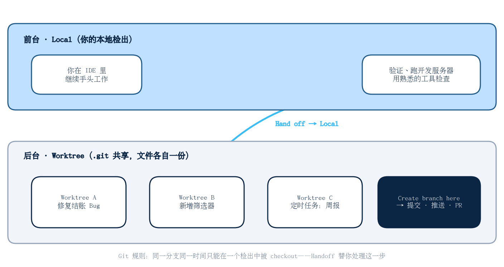
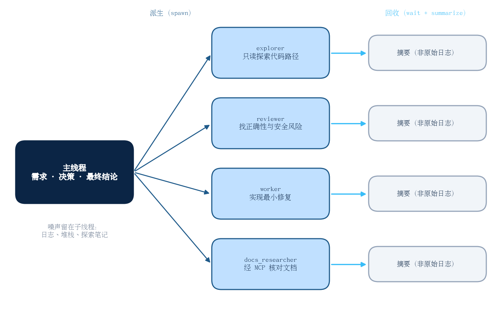
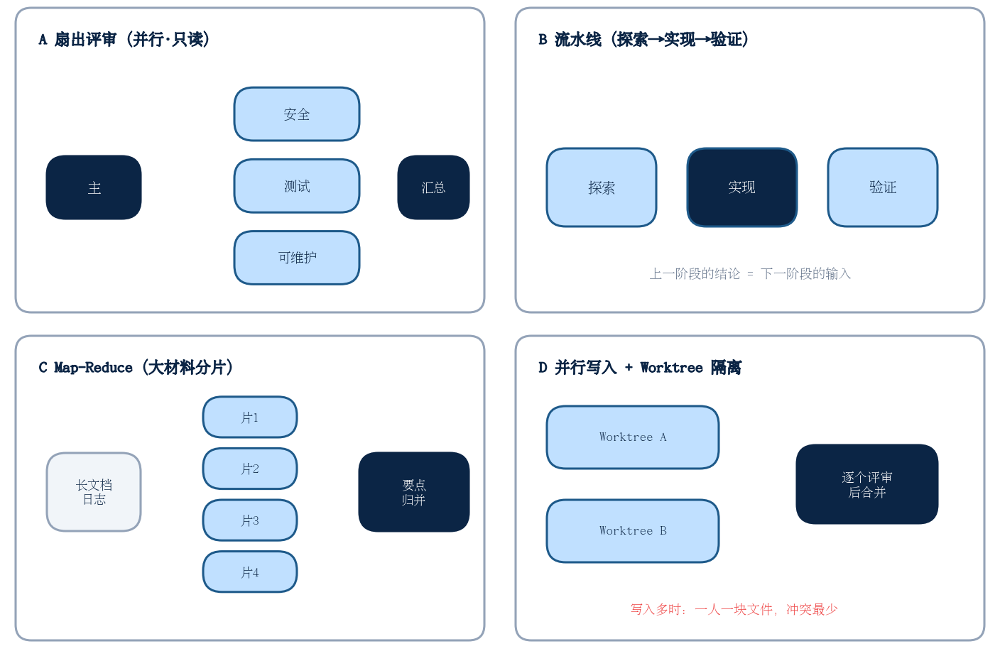
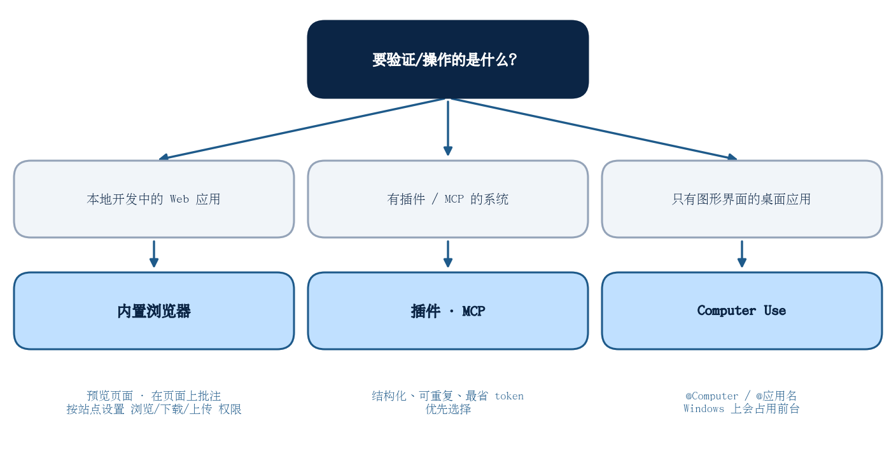
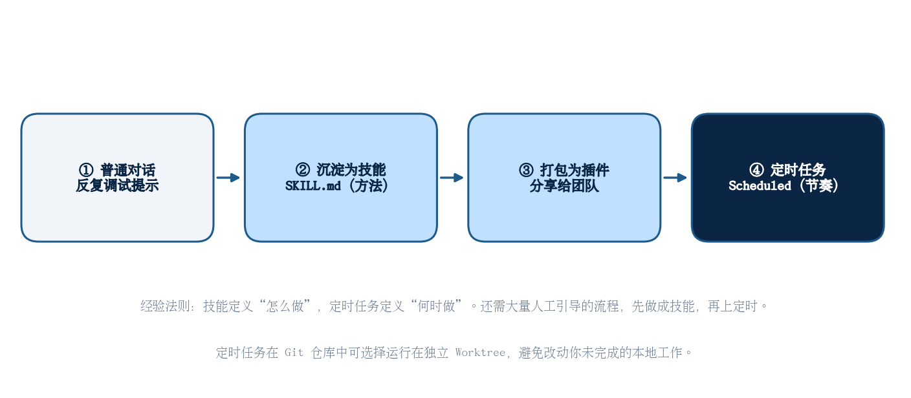

<!-- part: 第二部分 | 并行与子代理 | 从“一次一件事”到“同时推进多件事”：Worktree 让会话并行，子代理让一个代理变成一支团队。 -->

# 第 4 章　并行工作：多会话、Worktree 与本地环境

一个人同时只能专注一件事，但 Codex 不必如此。本章介绍如何在桌面应用中让多个对话安全地并行——关键在于理解 **Local（前台）** 与 **Worktree（后台）** 的分工。

## 4.1　为什么需要 Worktree

如果你在同一个检出目录里同时开三个对话，让它们分别修 Bug、加功能、写文档，它们会互相覆盖文件、打乱彼此的测试结果。Git Worktree 正是为此而生：它为仓库创建第二份“检出”，每份都有自己完整的文件副本，但共享同一份 `.git` 元数据（提交、分支等），因此可以在多个分支上并行工作 [15]。

桌面应用把这个机制包装得非常顺手。官方给出的三个理由是 [15]：

1. 与 Codex 并行工作，而不打扰你当前的本地环境；
2. 在你专注前台工作时，把后台任务排队执行；
3. 等你准备好检查、测试或协作时，再把对话移到本地。

## 4.2　在 Worktree 中开始一个对话

1. **选择 Worktree**。在新对话视图中，选择输入框下方的 **Worktree**（也可以输入 `/worktree`）。可以顺便选择一个本地环境，用于运行 Worktree 的初始化脚本 [7][15]。
2. **选择起始分支**。在输入框下方选择 Worktree 基于哪个分支：main、某个功能分支，或者带着未暂存改动的当前分支 [15]。
3. **提交提示**。Codex 会基于所选分支创建一个 Git Worktree；默认处于“分离 HEAD”状态 [15]。
4. **决定在哪里继续**。可以一直在 Worktree 上工作，也可以把对话**交接**（Hand off）到本地检出 [15]。



## 4.3　两条常见路径

把 Local 理解为**前台**、Worktree 理解为**后台**，Handoff 负责在两者之间移动对话 [15]。

**路径一：始终在 Worktree 上工作。** 如果你能直接在 Worktree 上验证改动——例如通过本地环境的初始化脚本装好了依赖——这是最省事的路径。点击对话标题栏的 **Create branch here**，把 Worktree 变成一个分支，然后提交、推送并在 GitHub 上开 PR。也可以用标题栏的 **Open** 按钮在 IDE 中打开该 Worktree，或使用集成终端 [15]。

**路径二：交接到 Local。** 当你想用平时的 IDE 窗口阅读改动、运行已有的开发服务器，或你的应用同一时间只能运行一个实例时，点击标题栏的 **Hand off**，把对话移到本地。Codex 会处理所需的 Git 操作——因为 Git 规定同一分支同一时间只能在一个检出中被 checkout [15]。

> [!WARNING]
> 如果你在某个 Worktree 上创建了分支，就不能在其他任何 Worktree（包括本地检出）中同时检出这个分支 [15]。遇到“分支已被检出”的错误时，先想想它是不是正被某个 Worktree 占用。

## 4.4　本地环境：初始化脚本与顶栏动作

Worktree 运行在与本地不同的目录中，项目可能还没装依赖、缺少未纳入版本控制的文件。**本地环境**（Local environments）解决这个问题，它只在桌面应用的 Codex 中可用，通过设置面板配置，配置文件保存在项目根目录的 `.codex` 文件夹中，可以提交到仓库与团队共享 [8]。

**初始化脚本**（Setup scripts）在 Codex 为新对话创建 Worktree 时自动运行。例如一个 TypeScript 项目 [8]：

```bash
npm install
npm run build
```

如果安装步骤因平台而异，可以分别为 macOS、Windows、Linux 定义脚本 [8]。

**动作**（Actions）用于定义常用任务，例如启动开发服务器或运行测试套件。它们以按钮形式出现在应用顶栏，在集成终端中运行，并可以为每个动作选择图标 [8]。一个“Run”动作可能只是一行 `npm start`。

> [!TIP]
> 把“装依赖 + 首次构建”写进初始化脚本，把“启动服务 / 跑测试”做成顶栏动作。这样每个新 Worktree 一创建就是可运行状态，Codex 可以直接在里面自测，你也可以一键验证。

## 4.5　管理大量对话

当并行对话多起来，下面这些功能能帮你保持秩序：

- **置顶**（`/pin` 或 ⌘ + ⌥ + P）重要对话；**归档**（`/archive`）已完成的对话，之后可在「设置 › Archived chats」中恢复 [6][7][9]；
- **分叉**（`/fork`）：把一个本地对话复制成新的本地对话或 Worktree，适合“从同一个起点尝试两种方案” [7]；
- **下一个需要关注的对话**（⌘ + ⌥ + A）：快速跳到等待你审批或回复的对话 [6]；
- **弹出窗口**：把正在进行的对话弹出到独立窗口，放在浏览器或编辑器旁边，并可开启 **Always on top** 置顶显示 [9]；
- **防止休眠**：在 macOS 和 Linux 上开启「设置 › General › Prevent sleep while running」，你离开时本地对话也能继续运行 [9]。

## 4.6　实战：同时推进三个需求

假设周一早上你有三件事：修复结账页 Bug、给问题看板加筛选器、生成上周的变更周报。

1. 在 Local 中保留你自己正在写的代码，不让任何对话碰它；
2. 新建对话 A，选择 **Worktree**，基于 main，提示“修复结账页优惠券为空时的 TypeError……完成标准：回归测试通过”；
3. 新建对话 B，同样选择 Worktree，基于 main，提示“为问题看板增加 Open/Closed 筛选，默认 All……”；
4. 对话 C 不需要改代码，选择只读权限，让它汇总上周提交；
5. 用 ⌘ + ⌥ + A 在需要关注的对话之间切换；A 完成后点 **Create branch here** 提交并开 PR；B 需要你在浏览器里看效果，于是 **Hand off** 到 Local，用顶栏的“Run”动作启动开发服务器验证。

三个任务互不干扰，你始终掌握主动权。

## 4.7　本章小结

- Worktree 为每个后台任务提供独立的文件副本，共享 `.git` 元数据；Local 是前台，Worktree 是后台。
- 两条路径：在 Worktree 上 **Create branch here** 直接提交，或 **Hand off** 到 Local 用熟悉的工具验证。
- 用本地环境的初始化脚本与顶栏动作，让每个 Worktree 开箱即用。

# 第 5 章　子代理：把一个代理变成一支团队

Worktree 让**多个对话**并行；子代理则让**一个对话内部**并行。本章是全书的重点之一：你将理解子代理为什么有效、如何在图形界面中触发和管理它们、如何定义自己的专职代理，以及四种经过验证的编排模式。

## 5.1　为什么需要子代理

即使上下文窗口很大，模型也有极限。如果把探索笔记、测试日志、堆栈跟踪、命令输出这些嘈杂的中间产物统统灌进主对话——那里本该只放需求、约束和决策——会话会随着时间推移变得越来越不可靠 [16]。官方把这种现象概括为两个词：

- **上下文污染**（context pollution）：有用的信息被嘈杂的中间输出淹没；
- **上下文腐化**（context rot）：对话里堆满不太相关的细节，表现随之下降。

子代理的解法很直接：把嘈杂的工作移出主线程 [16]。



- 主代理专注于需求、决策和最终产出；
- 专门的子代理并行负责探索、测试或日志分析；
- 子代理返回的是**摘要**，而不是原始的中间输出。

当工作可以独立并行时，子代理还能节省时间；对于超大的任务，例如分析一份数百万 token 的文档，Codex 可以把它拆成小问题，再把提炼后的要点交回主线程 [16]。

## 5.2　在图形界面中使用子代理

当前版本的 Codex 默认启用子代理工作流，子代理活动会出现在桌面应用、CLI 和 IDE 扩展中 [16]。

**如何触发。** 在本地 Codex 中，子代理不会凭空出现——你需要**直接提出**，或者让适用的 AGENTS.md 或技能指令要求委派 [16]。直接的说法包括“派生两个代理”“把这部分工作并行委派出去”“每一点用一个代理”。一个好的子代理提示应说明三件事：**如何划分工作、是否等所有代理完成再继续、要返回什么样的摘要** [16]。

```text
用并行子代理评审这个分支：一个查安全风险，一个查测试缺口，
一个查可维护性。等三个都完成后，按类别汇总发现，并附上文件引用。
```

**在桌面应用中查看。** 应用会把每个子代理线程展示出来，你可以点开查看它的工作过程，以及它返回给主对话的摘要 [16]。

**在 IDE 扩展中管理。** 当后台代理界面可用时，活动中的子代理显示在输入框上方。展开面板可以查看状态、**停止所有活动子代理**，或打开某个子代理线程 [16]。

**用对话来控制。** 在任何界面中，你都可以直接让 Codex 引导某个正在运行的子代理、停止它，或关闭已完成的子代理线程 [16]。

> [!NOTE]
> **审批会从子线程冒出来。** 子代理继承主对话的沙箱与审批设置，包括你用权限控件做的修改；自定义代理文件无法替换这些设置 [16]。因此，请在委派之前就为主对话选好权限模式。在非交互流程中，需要新审批的动作会失败，错误会回传给主工作流 [16]。

## 5.3　内置代理与模型选择

Codex 自带三个内置代理 [16]：

| 代理 | 定位 | 典型用途 |
|---|---|---|
| default | 通用兜底代理 | 没有特别指定时使用 |
| worker | 以执行为中心 | 实现功能、修复问题 |
| explorer | 以阅读为中心 | 探索代码库、追踪调用链 |

如果没有为子代理配置模型或推理强度，它会继承主代理的设置 [16]。你可以在提示里直接要求，例如“用 GPT-6 Luna 做快速扫描”，或为要求更高的子任务提高推理强度。官方建议：日常代理用 GPT-6.2 Sol；范围明确、可重复或高吞吐的工作用 GPT-6 Luna；评审者或安全类代理需要追踪复杂逻辑时用 **high** 推理强度 [16]。

> [!WARNING]
> 子代理工作流比同等的单代理运行消耗更多 token，因为每个子代理都独立进行模型推理和工具调用 [16]。不要为了“看起来高级”而使用子代理。

## 5.4　自定义代理

内置代理之外，你可以定义自己的专职代理：在 `~/.codex/agents/` 下放个人代理，或在项目的 `.codex/agents/` 下放项目级代理，每个 TOML 文件定义一个代理 [16]。每个文件必须包含三个字段：

- `name`：Codex 派生或引用该代理时使用的名字（以此为准，文件名只是惯例）；
- `description`：告诉人和 Codex 什么时候该用它；
- `developer_instructions`：定义其行为的核心指令。

可选地，用 `model`、`model_reasoning_effort` 等字段调整模型行为；用 `features.shell_tool = false` 等键收窄能力。注意：自定义代理会**继承**父会话的权限、模型提供方和 MCP 服务器，代理文件中的 `sandbox_mode`、`approval_policy`、`mcp_servers` 不会覆盖父配置 [16]。下面是一个只读探索者 [16]：

```toml
# .codex/agents/pr-explorer.toml
name = "pr_explorer"
description = "只读的代码库探索者，在提出修改前收集证据。"
model = "gpt-6-luna"
model_reasoning_effort = "high"
developer_instructions = """
保持探索模式，不要编辑文件。
追踪真实的执行路径，引用文件和符号；除非父代理要求，否则不要提出修复方案。
优先使用快速搜索和定向读文件，而不是大范围扫描。
"""
```

全局设置放在 `config.toml` 的 `[agents]` 表中，例如用 `max_concurrent_threads_per_session` 限制同一会话中并发打开的子代理线程数，用 `default_subagent_model` 设定子代理的默认模型 [16]。

> [!TIP]
> 最好的自定义代理**范围窄、观点鲜明**：给每个代理一项清晰的工作、一组与之匹配的工具，以及防止它越界到相邻工作的指令 [16]。注意：代理指令可以要求“不要编辑”，但这并不会创建一个独立的只读沙箱 [16]。

## 5.5　四种编排模式

经验表明，子代理最适合**读多写少**的任务——探索、测试、分诊、总结；并行写入要更谨慎，因为多个代理同时改代码会产生冲突并增加协调开销 [16]。基于这一原则，我们总结出四种模式，见图 5-2。



**A　扇出评审。** 主代理把同一份材料交给多个只读子代理，各自从不同角度审视，再汇总。官方示例是让每个评审点（安全、代码质量、Bug、竞态、测试稳定性、可维护性）各用一个代理，等全部完成后按点汇总 [16]。

**B　流水线。** 探索 → 实现 → 验证，上一阶段的结论是下一阶段的输入。官方的前端调试示例正是如此：`browser_debugger` 复现问题，`code_mapper` 追踪负责的代码路径，在故障模式清楚后由 `ui_fixer` 实施最小修复 [16]。

**C　Map-Reduce。** 面对超长的日志或文档，把材料分片交给多个子代理，各自提炼要点，再由主代理归并 [16]。

**D　并行写入 + Worktree 隔离。** 确实需要多个代理同时写代码时，让它们各自负责互不重叠的文件，最好在不同的 Worktree 中进行，最后逐个评审再合并。这其实是把第 4 章的 Worktree 与本章的子代理结合起来。

## 5.6　实战：三代理 PR 评审团队

官方文档提供了一个可以直接照搬的模式 [16]。在项目的 `.codex/config.toml` 中：

```toml
[agents]
max_concurrent_threads_per_session = 8

[mcp_servers.openaiDeveloperDocs]
url = "https://developers.openai.com/mcp"
```

再在 `.codex/agents/` 下定义三个代理：`pr_explorer`（见 5.4 节）负责梳理受影响的代码路径；`reviewer` 以“像负责人一样评审”为指令，聚焦正确性、安全、行为回归和缺失的测试，不做纯风格评论；`docs_researcher` 通过文档 MCP 服务器核对补丁所依赖的 API。

然后在桌面应用中，对着当前分支说：

```text
对照 main 评审这个分支。让 pr_explorer 梳理受影响的代码路径，
reviewer 找出真实风险，docs_researcher 核实补丁依赖的框架 API。
```

你会在聊天区看到三个子代理线程依次启动，最终主线程给出一份按类别整理、附带文件引用的报告。

## 5.7　什么时候不该用子代理

- 任务很小、几分钟就能做完——子代理的协调成本超过收益；
- 各部分强依赖、无法独立推进——串行反而更快；
- 多个代理会改同一批文件——冲突的代价远高于并行的收益；
- 额度紧张——每个子代理都独立消耗 token。

## 5.8　本章小结

- 子代理解决的是上下文污染与上下文腐化：噪声留在子线程，主线程只收摘要。
- 本地 Codex 需要你直接提出委派（或由 AGENTS.md/技能要求）；在应用中可以查看子代理线程，在 IDE 中可以停止它们。
- 自定义代理用 TOML 定义 `name`、`description`、`developer_instructions`；权限始终继承父会话。
- 四种模式：扇出评审、流水线、Map-Reduce、并行写入加 Worktree 隔离。读多写少最稳妥。

<!-- part: 第三部分 | GUI 进阶能力 | 让 Codex 看见并操作：浏览器、桌面应用、代码评审、外部工具与定时任务。 -->

# 第 6 章　让 Codex 看见并操作

到目前为止，Codex 都在和文件、命令打交道。但很多问题只有“看见”才能解决：页面布局错乱、桌面应用里的设置、只存在于某个系统里的数据。本章介绍桌面应用中让 Codex 走出终端的几项能力，以及如何把它接入外部工具、把重复工作变成定时任务。

## 6.1　选对工具：浏览器、插件还是 Computer Use

图 6-1 给出了一个简单的决策路径。



- **本地开发中的 Web 应用 → 内置浏览器**。官方建议，对于你在本地构建的 Web 应用，优先使用内置浏览器 [17]。在「设置 › Browser」中可以安装或启用内置的 Browser 插件，并按站点设置 **Browse**、**Download**、**Upload** 权限，选项包括 Requires approval、Always allow 和 Block [9]。
- **有插件或 MCP 的系统 → 结构化集成**。如果目标应用提供专门的插件或 MCP 服务器，数据访问和可重复操作应优先使用这种结构化集成 [17]。
- **只有图形界面的桌面应用 → Computer Use**。当任务依赖难以通过文件或命令输出验证的图形界面时，选择 Computer Use [17]。

## 6.2　Computer Use

在支持的地区，Computer Use 在 macOS 和 Windows 上可与 ChatGPT Work 和 Codex 一起使用，让它能看见并操作图形界面 [17]。

**设置。** 在桌面应用中选择 Codex，打开「设置 › Computer use」，在 Control 下找到 **Any App**：显示 Install 就点击安装，开关关闭就打开。首次使用某个应用时会请求你的许可；选择“未来任务都允许”的应用会出现在同一设置页的 **Always-allowed apps** 中 [17]。macOS 上还需要授予“屏幕录制”和“辅助功能”权限 [17]。

**发起任务。** 在提示中提及 `@Computer` 或 `@应用名`，并说清楚要操作的应用、窗口或流程 [17]：

```text
用 Computer Use 打开这个应用，复现新手引导的 Bug，
修复导致它的最小代码路径。每次修改后重新跑一遍同样的界面流程。
```

适合的场景包括：测试正在构建的 macOS/Windows 应用或 iOS 模拟器流程、复现只在图形界面出现的 Bug、修改需要点击界面才能完成的设置、跨多个应用的工作流 [17]。依赖截图和视觉判断的困难任务，可以在模型选择器中选择 GPT-6.2 Astra [17]。

> [!WARNING]
> **Windows 上 Computer Use 运行在当前活动桌面。** 它无法在你继续使用同一 Windows 会话时于后台运行，会接管鼠标、键盘和前台窗口 [17]。如果希望任务在你离开时继续，请保持设备解锁联网，用手机远程控制查看进度；或者把桌面应用运行在 Windows 虚拟机中，让 Computer Use 接管虚拟机而不是你的主桌面 [17]。

## 6.3　Code Review 插件

桌面应用内置 **Code Review**，可以从已安装插件中把它固定到侧栏 [18]。它展示 Pull Request 的描述、改动文件、评论和检查结果，帮你在批准前调查潜在问题。

1. 在侧栏打开 Code Review，按提示连接源代码账号；
2. 从侧栏选择 PR，或在搜索框输入 PR 链接；
3. 在 **Summary** 查看描述、动态、评论和检查；在 **Changes** 中对照差异查看文件和评论，逐个文件点击 **Mark as viewed** [18]。

个人收件箱可以按 **Assigned to me**、**Assigned to my team**、**Authored by me** 筛选跨仓库的 PR [18]。点击 **Review with Codex** 会在新对话中开始评审；点击旁边的齿轮可以设置**评审指令**，例如“先给简短摘要；优先关注行为变化、数据丢失和缺失的边界测试；每个发现说明触发输入、期望与实际行为” [18]。

> [!NOTE]
> 在对话中评审 PR **不会**自动发表评论、批准或合并——由你决定分享哪些发现 [18]。核实后，可以让 Codex 帮你按团队风格起草评审评论。

## 6.4　MCP：连接外部系统

当 Codex 需要的上下文在仓库之外、数据频繁变化、或你希望它使用工具而不是依赖粘贴的说明时，就该用 MCP（Model Context Protocol）[10]。MCP 服务器描述可用的工具并处理请求，例如查询工单或检索文档 [19]。

在桌面应用中添加服务器 [19]：

1. 打开「设置 › MCP servers」，点击 **Add server**；
2. 输入名称，选择 **STDIO**（本地进程）或 **Streamable HTTP**（远程地址），填写命令或 URL；
3. 保存后点击 **Restart**；需要 OAuth 的服务器点击 **Authenticate** 登录；
4. 在输入框中输入 `/mcp` 查看已连接的服务器。

桌面应用、CLI 和 IDE 扩展共享同一份 MCP 配置，配置一次即可在各客户端之间切换 [19]。

> [!TIP]
> 只在工具能解锁真实工作流时才添加它。不要一上来就接入所有工具：从一两个能明显消除你经常手动重复的环节的工具开始，再逐步扩展 [10]。

## 6.5　技能与插件

当某个工作流可以重复时，就不要再依赖冗长的提示和反复沟通。**技能**（Skill）把指令、上下文和辅助逻辑打包进一个 `SKILL.md` 文件，让 Codex 稳定地执行 [10][20]。

- **调用**：在输入框中输入 `$` 提及技能，或让 Codex 在任务匹配技能描述时自动选用；已启用的技能也会出现在斜杠命令列表中 [7][20]。
- **创建**：调用内置的 `$skill-creator`，它会询问技能做什么、何时触发、是否需要脚本 [20]。
- **存放**：个人技能在 `$HOME/.agents/skills`，团队技能可以提交到仓库的 `.agents/skills` 中 [10][20]。
- **分享**：想让更多人安装、或与连接器捆绑时，把技能打包为**插件** [20]。

技能最重要的部分是描述——它要说清技能做什么、什么时候用，并写上用户真正会说的触发词 [10]。

## 6.6　定时任务

当工作流稳定后，可以让 Codex 在后台按计划运行它。在桌面应用侧栏的 **Scheduled** 页面创建定时任务：选择项目、提示、频率，以及是在专用的 Git Worktree 还是本地环境中运行；提示中可以调用技能 [10][21]。

适合的任务包括：汇总最近的提交、扫描可能的 Bug、起草发布说明、检查 CI 失败、生成站会摘要 [10]。



> [!NOTE]
> 项目级定时任务需要电脑保持开机、桌面应用保持运行，所选项目在计划时间仍需存在于磁盘上 [21]。在 Git 仓库中选择 Worktree 运行，可以把定时任务的改动与你未完成的本地工作隔离开 [21]。CLI 和 IDE 扩展不提供定时任务管理界面，请在桌面应用或 ChatGPT 网页端创建和管理 [21]。

## 6.7　本章小结

- Web 应用用内置浏览器，有插件/MCP 的系统用结构化集成，只有图形界面的应用才用 Computer Use；Windows 上 Computer Use 会占用前台。
- Code Review 插件让你在应用内审阅 PR，评审结果是否发布由你决定。
- 在「设置 › MCP servers」中接入外部系统；用技能固化方法，用定时任务固化节奏。
