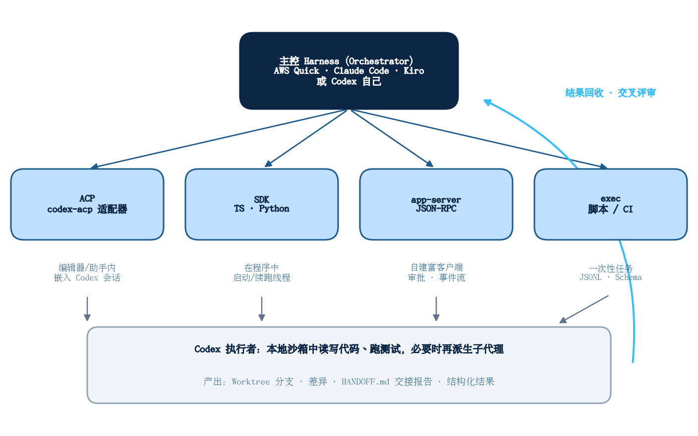
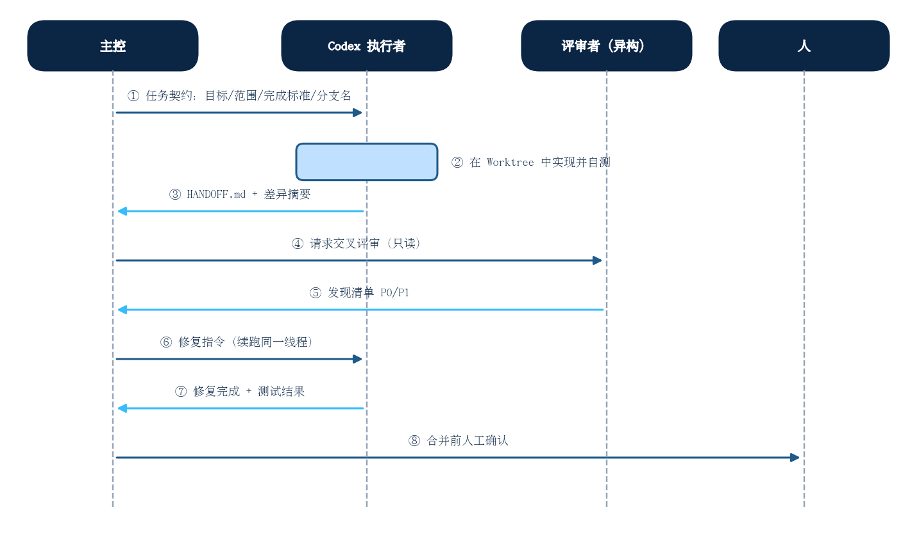
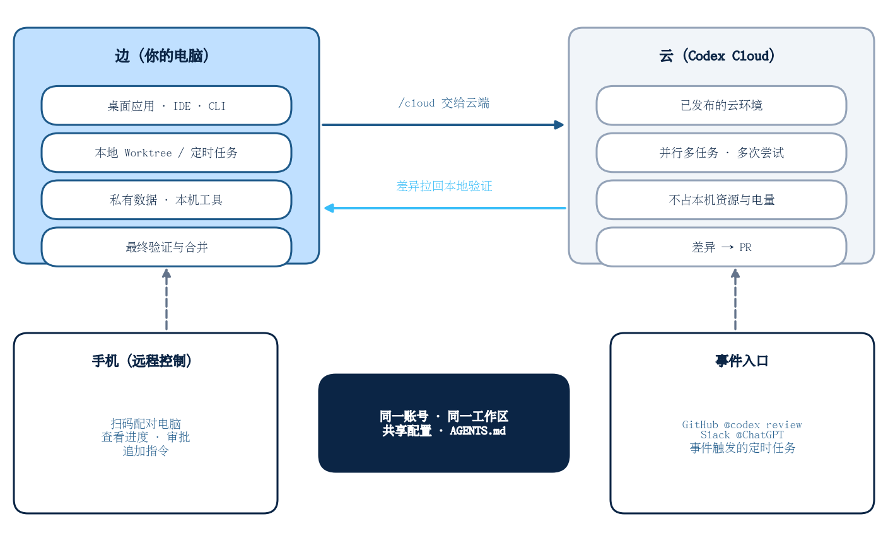
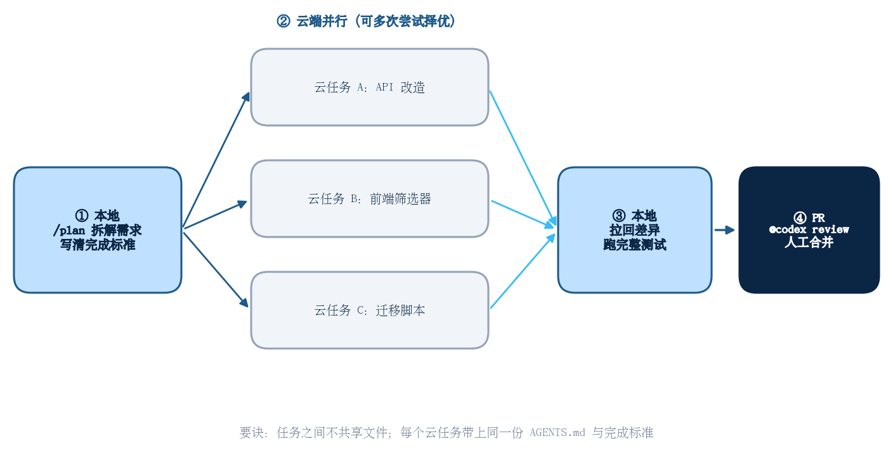

<!-- part: 第四部分 | 跨 Harness 派工 | Codex 不必单打独斗：它可以被其他代理调度，也可以去调度别人。 -->

# 第 7 章　跨 Harness 派工：被调度与去调度

越来越多的团队同时使用多个 AI 代理：一个擅长规划和沟通，一个擅长在本地仓库里写代码，一个负责评审。本章讨论如何让它们协作，而 Codex 在其中既可以是**执行者**，也可以是**主控者**。

## 7.1　什么是 Harness

在第 1 章我们提到，OpenAI 把 Codex 中负责代理循环与执行逻辑的核心称为 **harness**（直译为“挽具”）[3]。推而广之，任何把模型、工具、权限和会话管理组织起来的运行框架都可以叫 Harness：Codex 是一个，Claude Code、Kiro、AWS Quick 等也各有自己的 Harness。

**跨 Harness 派工**就是让一个 Harness（主控，Orchestrator）把任务交给另一个 Harness（执行者）完成，再把结果收回来。它的价值在于**各取所长**：例如让擅长连接企业数据和沟通的助手负责理解需求、拆分任务、跟进进度，让 Codex 在本地沙箱里真正改代码、跑测试。



## 7.2　让 Codex 被调度：四种接入方式

### 方式一：ACP 适配器（图形客户端首选）

**Agent Client Protocol**（ACP）是一种让编辑器和助手类客户端与编程代理对话的协议。开源项目 `codex-acp` 是一个基于标准输入输出的 ACP 代理服务器：它启动 Codex app-server，把 ACP 请求翻译成 Codex 操作，再把 Codex 事件映射回客户端 [25]。

对图形界面用户来说，这是最自然的方式：支持 ACP 的客户端可以像嵌入原生代理一样嵌入 Codex 会话，并在客户端自己的界面中呈现审批、差异、计划和终端输出。几个值得注意的能力 [25]：

- 支持 ChatGPT 登录、API Key 等认证方式，并可通过会话选项选择模型、推理强度、审批与沙箱模式；
- **Codex 的子代理会作为 ACP 子会话上报**，客户端可以分别展示并取消某个子代理的工作；
- 支持对话中途追加指令（steering）、`/review`、`/compact`、`/skills` 等斜杠命令，以及客户端提供的 MCP 服务器。

客户端一般只需配置一条启动命令：

```bash
npx -y @agentclientprotocol/codex-acp
```

> [!TIP]
> 如果你的主控助手本身支持“连接本机编程代理”（例如 AWS Quick 的编码代理功能），通常就是在背后通过这类适配器与本机的 Codex 建立会话。代码与命令始终在你的电脑上、在 Codex 的沙箱里运行。

### 方式二：Codex SDK（程序化调度）

当你要在自己的程序、CI 或内部工具里控制 Codex 时，使用 SDK [22]。TypeScript 版通过 `npm install @openai/codex-sdk` 安装（需 Node.js 18+）；Python 版通过 `pip install openai-codex` 安装（需 Python 3.10+），它通过 JSON-RPC 控制本地的 Codex app-server [22]。

下面是一个“主控脚本把任务派给 Codex，再续跑同一线程要求修复”的 Python 示例（依据官方 SDK 用法改写）：

```python
from openai_codex import Codex, Sandbox

with Codex() as codex:
    # 派工：在可写沙箱中启动线程
    thread = codex.thread_start(sandbox=Sandbox.workspace_write)
    plan = thread.run("诊断 CI 失败的原因，给出修复计划，不要改代码。")
    print(plan.final_response)

    # 续跑同一线程：执行计划
    result = thread.run("按计划实施修复，并运行相关测试。")
    print(result.final_response)

    # 换成只读沙箱，仅评审差异
    review = thread.run("只评审本次差异。", sandbox=Sandbox.read_only)
```

两个细节很关键。第一，**线程可以续跑和恢复**：同一线程上再次调用 `run()` 会带上历史；也可以凭线程 ID 恢复过去的线程 [22]。第二，**来自其他系统的内容要标明来源**：当工具、应用或另一个代理提供内容时，把它作为 `ExternalMessage` 传入，例如 `ExternalMessage(tool_name="issue_tracker", content=issue_body)`。Codex 会把它当作工具输出，优先级低于用户和开发者指令 [22]——这是防止“工单里藏着恶意指令”的重要护栏。

### 方式三：app-server（自建富客户端）

Codex app-server 是驱动 VS Code 扩展等富客户端的接口，提供认证、会话历史、审批和流式代理事件，使用双向 JSON-RPC 2.0 协议，实现开源在 Codex 仓库中 [23]。它适合要把 Codex 深度嵌入自家产品的团队。注意官方将该命令标注为**实验性**，不建议用于生产负载 [24]。

### 方式四：`codex exec`（脚本与 CI）

任何能执行 shell 命令的 Harness 都可以调用 `codex exec` 运行一次性任务：进度输出到标准错误，最终消息输出到标准输出；加 `--json` 可得到 JSON Lines 事件流，加 `--output-schema` 可要求结果符合指定的 JSON Schema [32]。第 10 章会再做简要介绍。

> [!WARNING]
> **旧的 `codex mcp-server` 已被移除。** 过去一些集成把 Codex 当作 MCP 服务器来调用，但 `codex mcp-server` 命令和独立的 `codex-mcp-server` 二进制已经删除，相关的 Agents SDK 示例也不再受支持。依赖它的集成必须在升级前迁移到 app-server（或基于它的 SDK/ACP 适配器）[24]。

表 7-1 汇总了选型建议。

| 你的需求 | 选择 | 理由 |
|---|---|---|
| 在编辑器或助手的图形界面里用 Codex | ACP 适配器 | 原生会话体验，子代理以子会话呈现 |
| 程序中启动、续跑、恢复线程 | SDK | 线程模型清晰，支持沙箱预设与外部消息 |
| 把 Codex 深度嵌入自家产品 | app-server | 完整的认证、审批、事件流（实验性） |
| 脚本、CI、一次性任务 | `codex exec` | 简单，可输出 JSONL 与结构化结果 |

## 7.3　让 Codex 去调度

反过来，Codex 也可以充当主控：

- **通过 MCP 或插件调用外部能力**。任何以 MCP 服务器形式提供的工具都能被 Codex 调用，例如工单系统、文档检索，甚至是封装了其他代理的服务 [19]。具有破坏性标注的应用/MCP 工具调用总是需要审批 [12]。
- **通过子代理在内部分工**（第 5 章）。
- **通过技能固化派工流程**。把“如何拆任务、交给谁、怎么验收”写进技能，让 Codex 每次都按同样的流程执行 [20]。

## 7.4　多 Harness 协作协议

不同 Harness 之间没有共享记忆，**唯一可靠的“共同语言”是文件和 Git**。我们推荐一套轻量协议，见图 7-2。



**1. 任务契约。** 主控在派工时给出与第 3 章相同的四要素，外加两项：**分支或 Worktree 名称**，以及**交接文件路径**。

**2. 隔离执行。** 执行者在独立的 Worktree 中工作，不碰主控或其他执行者的文件。

**3. 交接文件。** 执行者完成后写一份 `HANDOFF.md`，主控只读这份文件和差异摘要，而不是全部日志——这和子代理“回收摘要而非原始日志”是同一个道理。

```markdown
# HANDOFF.md
## 任务
修复结账页优惠券为空时的 TypeError（分支 fix/coupon-null）
## 改动
- src/checkout/coupon.ts：空值保护；新增 tests/coupon.test.ts
## 验证
- pnpm test：42 通过，0 失败
## 风险与未决
- 未覆盖多币种场景；建议评审者重点看第 37–52 行
```

**4. 交叉评审。** 让另一个 Harness（或 Codex 的只读评审子代理）评审差异。不同的模型和指令往往能发现彼此的盲点。

**5. 回收与修复。** 主控把评审发现交回执行者——用 SDK 时可以**续跑同一线程**，执行者因此保有完整上下文。

**6. 人工把关。** 合并前由人确认。代理可以写代码、跑测试、做评审，但“是否上线”这个决定应该留给人。

## 7.5　本章小结

- Harness 是组织模型、工具与权限的运行框架；跨 Harness 派工让各个代理各取所长。
- 让 Codex 被调度有四种方式：ACP 适配器、SDK、app-server、`codex exec`。旧的 `codex mcp-server` 已移除，需迁移。
- 外部内容用 `ExternalMessage` 传入，降低注入风险；协作时以 Worktree 隔离、以 HANDOFF.md 交接、以交叉评审把关。

<!-- part: 第五部分 | 云边协同 | 本地的掌控感，加上云端的并行与续航：在电脑、云端、手机与团队工具之间自由流转。 -->

# 第 8 章　Codex Cloud：把任务交给云端

本地运行让你看得见、摸得着，但会占用电脑资源，合上盖子就停。Codex Cloud 把任务放到 OpenAI 托管的环境中运行，你可以在网页、手机或桌面应用里查看结果、追加修改，并在准备好时提交或开 PR [26]。

## 8.1　从桌面应用发起云端任务

1. **选择 Cloud**。在网页或桌面应用中开始对话，选择 **Work in › Cloud**；在手机上打开 Codex [26]。桌面应用中也可以用 `/cloud` 让当前对话在云端运行，用 `/cloud-environment` 选择云环境，用 `/local` 切回所选的本地项目 [7]。
2. **选择环境**。如果有默认环境，可以不选仓库直接开始；也可以选择别人已经准备好的**已发布环境**。通过连接的 GitHub 或 GitLab 账号，Codex 可以检出你有权访问的仓库 [26]。
3. **发送任务**。可以先试一个不需要仓库的任务，例如“写一个按内容查找重复文件的 Python 脚本，并在示例文件上测试”[26]。

完成后，你可以检查改动的文件和验证结果，在同一对话中要求修改，然后提交或开 PR [26]。如果希望以后的任务使用相同的仓库和工具，可以创建并发布一个可复用的环境 [26]。

## 8.2　云端任务如何运行

理解云端任务的生命周期，能帮你写出更好的环境配置。官方文档描述了以下过程 [27]，见图 8-1。

》环境文档 [27] 与《Agent approvals & security》[12] 整理绘制。")

1. **创建容器**并检出所选分支或提交；默认使用名为 `universal` 的镜像，预装了常用语言和工具，可以在环境设置中固定 Python、Node.js 等版本 [27]；
2. **运行 setup 脚本**安装依赖（恢复缓存的容器时还可运行可选的维护脚本）；这一阶段**可以联网**；
3. **应用联网设置**：代理阶段的互联网访问**默认关闭**，可以按需开启受限或不受限的访问；
4. **代理循环**：运行终端命令、修改代码、执行检查；如果仓库有 AGENTS.md，代理会从中找到项目的 lint 和测试命令；
5. **产出**答案和改动差异，你可以开 PR 或继续追问 [27]。

**环境变量与 secrets。** 环境变量在整个任务期间都可用；secrets 经过额外加密，**只对 setup 脚本可用，在代理阶段开始前就会被移除** [27]。这意味着：需要令牌来安装私有依赖没问题，但不要指望代理在运行时还能读到它。

**缓存。** Codex 会把容器状态缓存最长约 12 小时，以加速新任务和追问。修改 setup 脚本、维护脚本、环境变量或 secrets 会自动使缓存失效；Business 和 Enterprise 用户的缓存在有权访问该环境的所有用户之间共享 [27]。

> [!NOTE]
> 当前的云端体验与旧版（Legacy）环境并存：旧版环境仍用于代码评审以及 Linear 和 GitHub 集成 [27]。具体可用的设置项请以你的工作区界面为准。

## 8.3　审阅与拉回

云端任务完成后，你在差异视图里审阅改动，满意就提交或开 PR [26]。如果想先在本地完整验证，有两种做法：一是开 PR 后在本地检出该分支；二是用 CLI 的 `codex apply <TASK_ID>` 把云端对话最新的差异直接应用到本地工作区，发生冲突时命令会以非零状态退出 [33]。

另外，CLI 的 `codex cloud exec --attempts` 可以让同一任务在云端跑 1～4 次尝试（best-of-N），从中挑选最好的一份 [33]——适合方案不确定、值得多试几次的任务。

## 8.4　本地还是云端

| 维度 | 本地（桌面应用 / IDE） | 云端（Codex Cloud） |
|---|---|---|
| 代码在哪里运行 | 你的电脑，OS 级沙箱 | OpenAI 托管的隔离容器 |
| 网络 | 默认关闭，可按需开启 | setup 阶段可联网；代理阶段默认关闭 |
| 并行与续航 | 受限于本机资源，需保持开机 | 多任务并行，不占本机资源 |
| 访问私有数据 / 本机工具 | 可以 | 只能访问环境中配置的内容 |
| 交互与可视化验证 | 强：差异面板、浏览器、Computer Use | 审阅差异、追问、开 PR |
| 适合 | 需要频繁交互、依赖本机环境的任务 | 边界清晰、可独立完成的长任务 |

## 8.5　本章小结

- 用 **Work in › Cloud** 或 `/cloud` 把任务交给云端，用 `/local` 切回本地。
- 云端任务经历：建容器 → setup（可联网、可读 secrets）→ 移除 secrets 并应用联网策略 → 代理循环 → 产出差异。
- 完成后审阅、开 PR，或用 `codex apply` 拉回本地验证。

# 第 9 章　云边协同工作流

单独使用本地或云端都不难，真正的威力来自把它们**串起来**：在本地想清楚，在云端并行做，回到本地验证合并；出门在外用手机审批；让 GitHub 和 Slack 里的事件自动触发协作。本章把这些拼成完整的工作流。



## 9.1　形态一：规划—并行—合并

这是最常用的模式，见图 9-2。



1. **本地规划**。在桌面应用中用 `/plan` 拆解需求，产出若干互不重叠的子任务，每个都写清完成标准。
2. **云端并行**。把每个子任务用 `/cloud` 发到云端执行。它们在各自的容器中运行，互不干扰；方案不确定的任务可以多尝试几次择优。
3. **本地验证**。把差异拉回本地，跑完整测试、在内置浏览器中看效果。
4. **PR 与评审**。开 PR 后让 Codex 自动评审，再由人合并。

> [!TIP]
> 让每个云任务都带上同一份 AGENTS.md 与清晰的完成标准；任务之间不要共享文件。这和第 5 章的“并行写入要隔离”、第 7 章的“任务契约”是同一条原则。

## 9.2　形态二：手机远程控制桌面电脑

有时任务必须在你的电脑上运行（依赖本地数据或工具），但你人不在电脑前。远程控制让你用手机查看进度、审批操作、发送指令，而任务在云端或你连接的电脑上运行 [28]。

1. **在电脑上开启**。打开 ChatGPT 桌面应用，进入「设置 › Connections › Control this Mac or PC」，选择 **Set up** 或 **Add**，批准远程访问并完成验证 [28]；
2. **扫码配对**。用手机扫描二维码，登录同一个 ChatGPT 账号与工作区，批准连接。只连接你拥有并信任的设备 [28]；
3. **在手机上工作**。在 ChatGPT iOS 应用中打开 Codex，选择已连接的电脑，开始或继续任务。电脑需要保持唤醒和联网 [28]。

Worktree 不会在手机上本地运行——手机控制的是你电脑上的 Codex，仓库和 Worktree 始终留在那台电脑上 [15]。这与第 6 章的提示呼应：Windows 上让 Computer Use 在你离开时继续工作，正是要配合远程控制使用 [17]。

## 9.3　形态三：事件驱动的协作

**GitHub：@codex review 与自动评审。** 把 GitHub 仓库连接到 Codex 后，在 PR 评论中写 `@codex review`，Codex 会先用一个“眼睛”表情回应，然后像队友一样发表一份评审。在 GitHub 中它只标注 P0 和 P1 级问题，让评论聚焦高优先级风险 [29]。在 Codex 设置中为仓库打开 **Automatic review**，之后的 PR 无需手动召唤即可自动评审 [29]。你还可以在 AGENTS.md 中加入 `## Code Review Rules` 一节，写下团队特有的评审规则 [29]；临时聚焦则直接写进评论，例如“@codex review for issues in the database migration”[29]。

**Slack：@ChatGPT 委派云任务。** 在启用了应用的频道中 `@ChatGPT` 并描述结果，例如“调查 acme/storefront 中失败的结账测试并提出修复”。如果工作区启用了 Cloud 委派，ChatGPT 会把仓库相关的工作发到一个独立的 Codex Cloud 任务，并把结果返回到原线程；在同一线程中继续 `@ChatGPT` 即可追加要求 [30]。这需要一个与工作区共享、已发布的云环境 [30]。

> [!WARNING]
> 发到 Slack 频道的回复，频道里所有人都能看到——私密的审批卡片并不会让结果回复变成私密的 [30]。不要在 Slack 提示中粘贴 secrets，仓库工作所需的凭据应通过环境的凭据控制提供 [30]。

**事件触发的定时任务。** 在符合条件的套餐中，ChatGPT 网页端和移动端的定时任务可以在 Gmail、Slack 或 GitHub 事件发生时运行，例如某仓库有新的 PR 活动时 [21]。注意：事件触发的任务**不能**在桌面应用、CLI 或 IDE 扩展中创建 [21]。

**GitHub Action：在 CI 中运行。** 如果你更希望在自己的流水线里控制一切，可以用官方的 `openai/codex-action@v1`，它会安装 Codex CLI、在提供 API Key 时启动 Responses API 代理，并在你指定的权限下运行 `codex exec` [31]。

## 9.4　实战：从 Slack 到合并的全链路

1. 产品经理在 Slack 频道中 `@ChatGPT`：“storefront 的优惠券为空时结账报错，请调查并提出修复，附回归测试。”
2. ChatGPT 将仓库工作委派给 Codex Cloud；任务开始时在线程中发布消息，请求者可以点击 **Follow along** 跟进 [30]。
3. 云任务完成，结果回到 Slack 线程；你在桌面应用中审阅差异，觉得需要在本地再验证，于是把改动拉回本地，用顶栏的 Run 动作启动服务，在内置浏览器中复现原场景。
4. 确认无误后在差异面板中推送分支、创建 PR；仓库已开启 Automatic review，Codex 自动给出评审；你处理掉一条 P1 意见后合并。
5. 下班路上，手机上收到另一个本地长任务的审批请求，你在手机上批准，让它继续运行。

整个过程中，**代码的每一次落地都经过了人的审阅**，而重复、耗时的部分都交给了代理。

## 9.5　安全边界清单

- 本地与云端的执行策略相互独立，需要分别测试；在设备之间切换不会授予访问另一台电脑的权限 [12]。
- secrets 只在云端 setup 阶段可用；不要把凭据写进提示、Slack 消息或 AGENTS.md [27][30]。
- 远程控制只连接你拥有并信任的设备 [28]。
- 在 CI 中，不要把 `OPENAI_API_KEY` 或 `CODEX_API_KEY` 设置为作业级环境变量，构建脚本、测试或被攻破的 Action 都可能读到它们；GitHub Actions 优先使用官方 Action [32]。

## 9.6　本章小结

- 规划—并行—合并：本地 `/plan`，云端 `/cloud` 并行，本地验证，PR 评审后人工合并。
- 远程控制：「设置 › Connections」扫码配对，用手机审批与追加指令，代码仍在你的电脑上。
- 事件驱动：GitHub `@codex review` 与自动评审、Slack `@ChatGPT` 委派云任务、事件触发的定时任务、GitHub Action。
