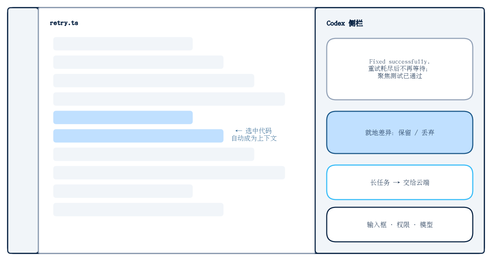

# 第 10 章　IDE、CLI 速成与最佳实践

最后一章收拢三件事：在编辑器里用 Codex，用一页纸掌握 CLI，以及一份可以贴在显示器旁边的最佳实践清单。

## 10.1　IDE 扩展

如果你大部分时间都在编辑器里，IDE 扩展能让 Codex 从你正在看的代码开始工作，省去重复描述问题的时间 [34]。

**安装与打开。** VS Code、Cursor、Windsurf 使用 Codex 扩展：点击活动栏中的 Codex 图标；如果看不到，打开命令面板运行 **Codex: Open Codex Sidebar**。Xcode 中打开编码助手，新建对话并选择 Codex；JetBrains IDE 中打开 AI Chat 并选择 Codex [34]。



**三个核心用法** [34]：

- **用好已打开的上下文**：在输入框中直接引用打开的文件、选中的代码和最近的对话，Codex 从你正在看的代码开始；
- **在代码旁审阅**：阅读摘要、检查聚焦的差异，在同一对话中追问，只保留你想要的改动；
- **任务变大时委派**：快速迭代留在本地，需要更多时间和资源时交给云端，回来时仍在同一个编辑器工作流中审阅结果。

IDE 扩展与桌面应用、CLI 共享配置；在扩展中点击右上角齿轮，选择 **Codex Settings › Open config.toml** 即可打开配置文件 [14]。在桌面应用中，`/ide-context` 可以开关共享的 IDE 上下文 [7]。

## 10.2　CLI 一页速成

即便你以图形界面为主，了解少量命令也很有用——尤其是做自动化或排查问题时。

**安装** [2]：

```bash
# macOS / Linux
curl -fsSL https://chatgpt.com/codex/install.sh | sh
# Windows（PowerShell）
powershell -ExecutionPolicy ByPass -c "irm https://chatgpt.com/codex/install.ps1 | iex"
# 或使用包管理器
npm install -g @openai/codex
```

**交互使用。** 在项目目录中运行 `codex` 即进入终端界面，首次运行时选择 **Sign in with ChatGPT** [1]。界面中常用的斜杠命令有 `/init`、`/status`、`/permissions`、`/model`、`/review` [1]，与桌面应用基本一致。

**非交互使用（`codex exec`）** [32]：

```bash
# 只把最终消息输出到 stdout，便于管道处理
codex exec "根据最近 10 次提交生成发布说明" | tee release-notes.md

# 默认只读；需要改文件时显式放开写权限
codex exec --sandbox workspace-write "修复 lint 错误并运行测试"

# 结构化输出：要求结果符合 JSON Schema
codex exec "提取项目元数据" --output-schema ./schema.json -o ./meta.json

# 两阶段流水线：续跑上一次会话
codex exec "检查这次改动中的竞态条件"
codex exec resume --last "修复你发现的竞态条件"
```

**其他常用命令** [33]：`codex review --uncommitted` 非交互地评审未提交改动；`codex resume` / `codex fork` 继续或分叉过去的会话；`codex apply <TASK_ID>` 把云端差异应用到本地；`codex doctor` 生成安装、配置、认证和运行环境的诊断报告。

> [!WARNING]
> `--yolo`（即 `--dangerously-bypass-approvals-and-sandbox`）会在没有审批和沙箱的情况下运行所有命令，只应在外部已经隔离加固的环境中使用 [33]。旧的 `--full-auto` 已不再支持，请改用 `--sandbox workspace-write` [32]。

## 10.3　十条黄金习惯

1. **先建检查点**。任务前后各做一次 Git 提交，随时可以回退 [1]。
2. **四要素写提示**。目标、上下文、约束、完成标准，一个都别少 [10]。
3. **难题先计划**。复杂或模糊的任务先 `/plan`，或者让 Codex 先采访你 [10]。
4. **权限从紧开始**。默认 Ask for approval；只在可信仓库、确有需要时放宽 [10]。
5. **AGENTS.md 越短越好**。同样的错误出现第二次，就让 Codex 复盘并更新它 [10]。
6. **后台工作进 Worktree**。前台留给自己，后台交给 Codex，Handoff 负责交接 [15]。
7. **子代理读多写少**。探索、评审、分诊用子代理；并行写入要隔离 [16]。
8. **让 Codex 自证**。要求它写测试、跑检查、确认行为，再用 `/review` 看一遍差异 [10]。
9. **重复工作做成技能**。同一个提示用了三次，就该把它变成技能；稳定后再上定时任务 [10]。
10. **人做最终决定**。代理可以写、测、评，合并与上线由人拍板。

## 10.4　常见问题与排查

| 现象 | 可能原因 | 处理办法 |
|---|---|---|
| AGENTS.md 似乎没生效 | 不在预期的仓库目录；文件为空；更高层存在 override 文件 | 确认工作目录；检查 `AGENTS.override.md`；重新开始会话 [13] |
| 命令总在请求审批 | 需要联网或访问工作区外的路径 | 判断是否必要；必要时选最窄的审批范围 [11] |
| 分支无法检出 | 该分支正被某个 Worktree 占用 | 在 Worktree 中继续，或用 Hand off 交接 [15] |
| 对话越来越“健忘” | 上下文被中间输出塞满 | `/compact` 压缩上下文；把噪声工作交给子代理 [7][16] |
| 子代理没有启动 | 本地 Codex 不会主动委派 | 在提示中明确要求，或在 AGENTS.md/技能中写明 [16] |
| 云任务找不到依赖 | setup 脚本未安装；`export` 不会延续到代理阶段 | 在 setup 中安装；需持久的变量写入 `~/.bashrc` 或环境设置 [27] |
| 额度消耗过快 | 长对话、高推理强度、大量子代理 | 用 `/status` 查看占用；为简单任务降低推理强度 [7][35] |

## 10.5　本章小结

- IDE 扩展：选中即上下文，就地审阅，大任务交给云端；与桌面应用共享配置。
- CLI 只需记住 `codex`、`codex exec`、`codex review`、`codex apply`、`codex doctor`。
- 好习惯比好提示更重要：检查点、四要素、从紧的权限、短小的 AGENTS.md、让代理自证、由人拍板。

# 附录 A　斜杠命令与快捷键速查

下表摘录自桌面应用的斜杠命令参考 [7]，可用的命令会随环境和权限而变化。

| 命令 | 作用 |
|---|---|
| `/plan` | 切换计划模式，做多步规划 |
| `/goal` | 设定持久目标，进度条可暂停、编辑、清除 |
| `/side` | 开启临时旁支对话，不打断主对话 |
| `/review` | 评审未提交改动或与基准分支对比 |
| `/init` | 为当前项目生成 AGENTS.md 骨架 |
| `/worktree` | 在新的 Git Worktree 中运行对话 |
| `/fork` | 把本地对话复制为新的本地对话或 Worktree |
| `/cloud` · `/cloud-environment` | 在云端运行对话 · 选择云环境 |
| `/local` | 在所选本地项目中运行对话 |
| `/model` · `/reasoning` | 选择模型 · 选择推理强度 |
| `/compact` | 压缩当前对话的上下文 |
| `/mcp` | 查看已连接的 MCP 服务器 |
| `/memories` | 配置本对话是否使用或生成记忆 |
| `/status` · `/usage` | 对话 ID、上下文占用与速率限制 · 用量与账单 |
| `/pin` · `/archive` · `/rename` | 置顶 · 归档 · 重命名对话 |
| `/approve` | 在自动审查生效时，批准一次近期被拒操作的重试 |

在输入框中，`@` 引用文件，`$` 调用技能，自定义提示以 `/prompts:<名称>` 形式出现 [7]。快捷键见第 2 章表 2-1。

# 附录 B　配置样例

下面是一份可以作为起点的 `~/.codex/config.toml`，各键的含义见 Config basics [14] 与 Subagents [16]。项目级的 `.codex/config.toml` 只在你信任该项目时加载 [14]。

```toml
# ~/.codex/config.toml —— 个人默认值
model = "gpt-6.1-sol"              # 默认模型（以你的套餐可用为准）
model_reasoning_effort = "medium"  # 推理强度
approval_policy = "on-request"     # 越界时请求审批
sandbox_mode = "workspace-write"   # 工作区内可写
web_search = "cached"              # 默认使用缓存的网页搜索结果

[sandbox_workspace_write]
network_access = false             # 命令默认不联网

[agents]
max_concurrent_threads_per_session = 6
default_subagent_model = "gpt-6-luna"

[mcp_servers.openaiDeveloperDocs]
url = "https://developers.openai.com/mcp"
```

一个代码评审用的自定义代理（放在 `.codex/agents/reviewer.toml`）[16]：

```toml
name = "reviewer"
description = "专注正确性、安全与缺失测试的 PR 评审者。"
model = "gpt-6.2-sol"
model_reasoning_effort = "medium"
developer_instructions = """
像负责人一样评审，不要编辑文件。
优先关注正确性、安全、行为回归和缺失的测试覆盖。
先给出具体发现，尽量附复现步骤；除非掩盖了真实 Bug，否则不做纯风格评论。
"""
```

配置的优先级从高到低为：命令行参数与 `--config` 覆盖 → 项目 `.codex/config.toml`（越近越优先，仅受信任项目）→ `--profile` 指定的配置文件 → 用户 `~/.codex/config.toml` → 云端托管默认值 → 系统配置 → 内置默认值 [14]。

# 参考文献与图片来源

## 参考文献

本书引用的资料均为在线文档，访问日期均为 2026-11-27，著录格式参照 GB/T 7714—2015。

[1] OpenAI. Features – Codex CLI[EB/OL]. [2026-11-27]. https://developers.openai.com/codex/cli/features.

[2] OpenAI. openai/codex: Lightweight coding agent that runs in your terminal[CP/OL]. GitHub. [2026-11-27]. https://github.com/openai/codex.

[3] OpenAI. Unrolling the Codex agent loop[EB/OL]. [2026-11-27]. https://openai.com/index/unrolling-the-codex-agent-loop/.

[4] OpenAI. ChatGPT desktop app – Codex[EB/OL]. [2026-11-27]. https://developers.openai.com/codex/app.

[5] OpenAI. ChatGPT desktop app for Windows[EB/OL]. [2026-11-27]. https://developers.openai.com/codex/app/windows.

[6] OpenAI. Commands (desktop app)[EB/OL]. [2026-11-27]. https://developers.openai.com/codex/app/commands.

[7] OpenAI. Slash commands (desktop app)[EB/OL]. [2026-11-27]. https://developers.openai.com/codex/app/slash-commands.

[8] OpenAI. Local environments[EB/OL]. [2026-11-27]. https://developers.openai.com/codex/app/local-environments.

[9] OpenAI. Settings[EB/OL]. [2026-11-27]. https://developers.openai.com/codex/app/settings.

[10] OpenAI. Best practices[EB/OL]. [2026-11-27]. https://developers.openai.com/codex/learn/best-practices.

[11] OpenAI. Sandbox[EB/OL]. [2026-11-27]. https://developers.openai.com/codex/concepts/sandboxing.

[12] OpenAI. Agent approvals & security[EB/OL]. [2026-11-27]. https://developers.openai.com/codex/agent-approvals-security.

[13] OpenAI. Custom instructions with AGENTS.md[EB/OL]. [2026-11-27]. https://developers.openai.com/codex/guides/agents-md.

[14] OpenAI. Config basics[EB/OL]. [2026-11-27]. https://developers.openai.com/codex/config-basic.

[15] OpenAI. Worktrees[EB/OL]. [2026-11-27]. https://developers.openai.com/codex/app/worktrees.

[16] OpenAI. Subagents[EB/OL]. [2026-11-27]. https://developers.openai.com/codex/subagents.

[17] OpenAI. Computer Use[EB/OL]. [2026-11-27]. https://developers.openai.com/codex/app/computer-use.

[18] OpenAI. Code review (desktop app)[EB/OL]. [2026-11-27]. https://developers.openai.com/codex/app/review.

[19] OpenAI. Model Context Protocol[EB/OL]. [2026-11-27]. https://developers.openai.com/codex/mcp.

[20] OpenAI. Build skills[EB/OL]. [2026-11-27]. https://developers.openai.com/codex/skills.

[21] OpenAI. Scheduled tasks[EB/OL]. [2026-11-27]. https://developers.openai.com/codex/app/automations.

[22] OpenAI. Codex SDK[EB/OL]. [2026-11-27]. https://developers.openai.com/codex/sdk.

[23] OpenAI. Codex App Server[EB/OL]. [2026-11-27]. https://developers.openai.com/codex/app-server.

[24] OpenAI. Codex MCP server removal[EB/OL]. [2026-11-27]. https://developers.openai.com/codex/guides/agents-sdk.

[25] Agent Client Protocol. codex-acp: ACP adapter for Codex CLI[CP/OL]. GitHub. [2026-11-27]. https://github.com/agentclientprotocol/codex-acp.

[26] OpenAI. Run coding tasks in the cloud[EB/OL]. [2026-11-27]. https://developers.openai.com/codex/cloud.

[27] OpenAI. Codex Cloud (Legacy): environments[EB/OL]. [2026-11-27]. https://developers.openai.com/codex/cloud/environments.

[28] OpenAI. Remote control from your phone[EB/OL]. [2026-11-27]. https://developers.openai.com/codex/remote.

[29] OpenAI. Review GitHub pull requests with Codex[EB/OL]. [2026-11-27]. https://developers.openai.com/codex/integrations/github.

[30] OpenAI. Use ChatGPT in Slack[EB/OL]. [2026-11-27]. https://developers.openai.com/codex/integrations/slack.

[31] OpenAI. Codex GitHub Action[EB/OL]. [2026-11-27]. https://developers.openai.com/codex/github-action.

[32] OpenAI. Non-interactive mode[EB/OL]. [2026-11-27]. https://developers.openai.com/codex/noninteractive.

[33] OpenAI. Developer commands (CLI reference)[EB/OL]. [2026-11-27]. https://developers.openai.com/codex/cli/reference.

[34] OpenAI. Codex IDE extension[EB/OL]. [2026-11-27]. https://developers.openai.com/codex/ide.

[35] OpenAI. Pricing[EB/OL]. [2026-11-27]. https://developers.openai.com/codex/pricing.

## 图片版权与来源

本书共有 1 幅封面插图与 18 幅示意图。所有示意图均由作者依据所列参考文献原创绘制（使用 Python matplotlib），描述的是产品的结构、流程与界面布局，**均非产品真实截图**，界面细节可能与实际产品不同。图中出现的产品名称为其所有者的商标。

| 图号 | 图题 | 依据资料 |
|---|---|---|
| 封面 | 版画风格章鱼插图 | AI 图像生成工具创作，作者选用；寓意“多臂协作” |
| 图 1-1 | Codex 的四种入口共享同一个代理内核 | [2][14][34] |
| 图 1-2 | 代理循环 | [3] |
| 图 2-1 | 桌面应用 Codex 界面分区示意 | [4][7][8][11] |
| 图 2-2 | 差异面板的审阅流程与行内批注 | [8][10] |
| 图 3-1 | 好提示的四个要素 | [10] |
| 图 3-2 | 权限选项与沙箱、审批策略的对应关系 | [11][12][14] |
| 图 3-3 | AGENTS.md 的分层发现与合并顺序 | [13] |
| 图 4-1 | Local 与 Worktree 之间的 Handoff | [15] |
| 图 5-1 | 主线程派生子代理并回收摘要 | [16] |
| 图 5-2 | 四种子代理编排模式 | [16] |
| 图 6-1 | 内置浏览器、插件/MCP 与 Computer Use 的分工 | [9][17] |
| 图 6-2 | 从对话到技能、插件与定时任务 | [10][21] |
| 图 7-1 | 多 Harness 协作拓扑 | [22][23][25][32] |
| 图 7-2 | 派工—交接—回收的时序 | 作者原创设计；参考 [15][16][22] |
| 图 8-1 | Codex Cloud 任务的五个阶段 | [12][27] |
| 图 9-1 | 云边协同全景 | [26][28][29][30] |
| 图 9-2 | 本地规划、云端并行、本地合并 | 作者原创设计；参考 [10][26][33] |
| 图 10-1 | IDE 扩展工作区示意 | [34] |

图题编号规则为“图 章号-序号”，图题置于图下方，来源说明紧随图题，以“来源：”开头，方括号中的数字对应参考文献编号。
